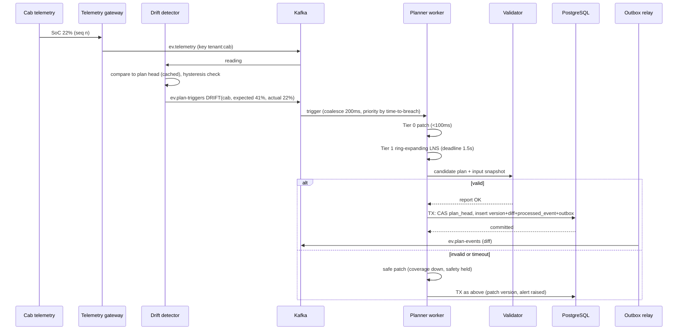

I've locked in ALNS with a min-cost-flow charging re-timer, the response-ladder re-planner, and Java, Spring Boot, PostgreSQL and Kafka. While stress-testing that combination I found problems in my own earlier proposals, so I've corrected those first.

---

# 0. Corrections to what I told you earlier

1. **The "bipartite matching" lower bound was wrong.** A cab does many trips, so one-trip-per-cab matching isn't a valid bound. The replacement bounds are in section 3.
2. **The flow re-timer is exact only if charging can be split into pieces.** Real sessions are contiguous blocks, and scheduling variable-length blocks in windows is NP-hard. So the flow is a relaxation that gives a cost lower bound and guides placement, followed by a repair step that makes sessions contiguous. The gap between the two is reported.
3. **Hard rules are invariants, coverage is soft.** If anything fails (timeout, exception, bad data), the system degrades coverage by pushing trips to backup cabs. It never degrades battery or charger safety.

---

# 1. Failure risks and how the design closes them

| Risk | Why it could sink the whole flow | Design answer |
|---|---|---|
| Solver misses the 2s deadline | Operators get nothing | Every operator polls a deadline. Tier 0 is a deterministic patch under 100ms. The last validated plan is always available. |
| Solver produces an invalid plan | Cab strands | **Nothing is published without passing the independent validator.** Failure means keep the old plan plus a safe patch. |
| Float rounding makes planner and validator disagree | Phantom violations or hidden ones | All math is in integers: Wh, metres, seconds, micro-currency. SoC is stored as Wh, never %. Rounding is conservative (energy up, time up). |
| Drift storm (city-wide jam, 100 cabs at once) | Re-plan queue collapses, thrashing | Coalesce events within ~200ms. Priority is "time to breach". One multi-cab re-plan runs per window. |
| Re-plan thrash from sensor noise | Operators lose trust | Hysteresis (act only if projected breach or deviation above a threshold), per-cab cooldown, lock window on imminent trips, a change budget. |
| Bad telemetry (SoC jumps 60% to 5%) | Needless chaos or missed danger | Rate-of-change sanity filter. Quarantine until a second consistent reading, except below a critical level, where act-first applies. |
| Telemetry silence (cab offline) | Plan assumes data that doesn't exist | A staleness timer degrades the cab's SoC estimate conservatively and marks it "unverified". |
| Cab already below 15% at event time | Floor can't be satisfied retroactively | Emergency mode: nearest reachable charger first, its trips are re-homed, and the incident is flagged. |
| Cab ends a trip with no reachable charger ("dead-end") | Technically legal, operationally stranded | A **reserve-to-hub invariant**: after every trip, the cab must retain enough charge to reach some charger above the floor. Configurable. |
| Charger fails mid-session | Cab left half-charged | Session truncated at the telemetry SoC, then the cab goes through the ladder. Sessions queued behind it shift. |
| Two planners write at once (rebalance, zombie instance) | Corrupt or forked plan | One writer per shard via Kafka partition ownership, plus **compare-and-set on the plan head** as a fence. |
| Duplicate, late or out-of-order events | Stale data overwrites fresh | Per-producer sequence numbers, a unique-key dedupe table, and last-write-wins by event-time with a watermark. |
| DST or midnight-crossing shifts | Wrong tariff window | Tariffs are stored in the hub's local zone. Internal time is epoch UTC. Tests cover DST days. |
| New or cancelled trips mid-shift | Spec says "fixed", reality doesn't | Handled as events through the same ladder. |
| Hot or huge tenant | Starves others | Shard key `tenant:shift`. Planner threads run on a bounded pool separate from Kafka consumers. |
| Backup supply assumed infinite | Reports lie if the pool is finite | Backup count is reported as demand. An optional pool cap raises an alert. |

---

# 2. Architecture

```
 Operator UI / Admin / Employee app
            │ HTTPS + JWT (OIDC via Keycloak, tenant + role claims)
            ▼
 ┌──────────────────────┐   REST commands    ┌────────────────────────────┐
 │ API service          │───────────────────▶│ PostgreSQL                 │
 │ (controller/service/ │◀── read models ────│ RLS per tenant, plan log,  │
 │  repository)         │                    │ outbox, dedupe table       │
 └──────────┬───────────┘                    └──────▲───────────▲─────────┘
            │ plan-triggers                         │ CAS       │ outbox poll
            ▼                                       │ commit    │ (SKIP LOCKED)
 ┌──────────────────────────────── Kafka ────────────────────────────────┐
 │ ev.telemetry  ev.charger-status  ev.plan-triggers  ev.plan-events      │
 │ *.retry.5s  *.retry.1m  *.dlq        (Protobuf + Schema Registry)      │
 └───▲──────────────┬───────────────────────▲──────────────┬─────────────┘
     │              ▼                       │              ▼
 Telemetry     Drift Detector ──────▶  Planner Worker   Projector /
 gateway       (keyed by cab,          (single writer   cache invalidator /
               compares to plan head)   per shard)      notifications
                                        │
                              ┌─────────┴──────────┐
                              │ planner-core (pure │   ┌──────────────┐
                              │ Java, no Spring)   │   │ validator    │
                              │ ALNS + flow + LB   │──▶│ (independent)│
                              └────────────────────┘   └──────────────┘
 Observability: Micrometer→Prometheus→Grafana, OpenTelemetry traces, JSON logs
```

**Maven modules** (boundaries enforced with ArchUnit):
- `ev-domain`: immutable value objects in integer units.
- `ev-planner-core`: ALNS, flow re-timer, lower bounds, diagnosis. Pure Java.
- `ev-validator`: **depends only on `ev-domain`**, never on the planner. An ArchUnit test fails the build if it does.
- `ev-service`: Spring Boot app (API, Kafka, persistence, security).
- `ev-sim`: scenario generator (300 cabs / 40 chargers / 1,500 trips), drift injector, load driver.
- `ev-bench`: JMH and k6 scripts.

**One-command run:** `docker compose up` starts 2 app instances (to demonstrate failover), Postgres, Kafka (KRaft, no ZooKeeper), Schema Registry, Keycloak with an imported realm, Prometheus, and Grafana with a preloaded 3 AM dashboard. Compose uses replication factor 1, and the README states the production setting is 3 with `min.insync.replicas=2`.

---

# 3. Core planner design

**Representation.** A cab route is an ordered list of stops (`Trip`, `Charge`). Deadhead legs are derived. Each stop caches forward SoC and arrival time plus **backward slack** (how much delay or energy deficit downstream tolerates). This is the standard time-window-VRP technique, extended with energy, so the feasibility of inserting a trip is checked in O(1) rather than by re-simulating the route.

**Constraints, all hard:**
- Floor: SoC ≥ 15% after every driving segment, deadhead included. Consumption is `base × traffic(t) × AC` with a **robustness margin** (effective floor of about 17-18% for planning, with the true 15% enforced by the validator).
- Charger capacity per hub via a difference-array timeline at 60s resolution. Assigning specific plug IDs afterwards always works, because interval graphs are perfect.
- Power during a session is `min(charger kW, vehicle max acceptance kW)`, which is an extra field you need on the vehicle model.
- Time: arrive by trip start, finish by the latest allowed finish.

**Charging curve model.** Piecewise linear. Fast segment up to 80% at power P1 (taper ignored), slow segment above at P2 < P1. Session duration is a deterministic function of start SoC and target SoC, so every session is a known-length interval.

**Target SoC decision.** Plug time is the scarce resource, so each plan carries a plug-time shadow price (from charger utilisation). Charging above 80% is chosen only when the plug is idle anyway or the next trips need it.

**Objective (explicit tuple, no magic "big M"):**
- Initial plan: `(backupTrips, chargingCost)`.
- Re-plan: `(backupTrips, λ·changedAssignments + chargingCost)` with a hard change budget.

Costs are integer micro-units, so ties and overflow are deterministic.

**Algorithm pipeline:**
1. **Pre-screen.** Trips impossible for any cab even at 100% go straight to backup with reason `INTRINSICALLY_INFEASIBLE`.
2. **Greedy construction.** Trips by start time and by "fewest feasible cabs" (most constrained first), with regret-2 insertion and a charge-stop insertion fallback.
3. **ALNS.** Destroy operators: time-window cluster, hub cluster, worst-slack, random related. Repair operators: greedy, regret-2, regret-3. Operator weights adapt, with simulated-annealing acceptance. The seed is stored with the plan, so any result is **reproducible** at 3 AM.
4. **Flow re-timer** (after each improvement phase and at the end): with assignments frozen, solve the preemptive relaxation as min-cost flow (sessions → slots → hub capacity, tariff as cost). That yields the cost lower bound. Then convert to contiguous blocks, accepting only moves that keep feasibility.
5. **Validate**, then publish.

**Complexity.** With T trips, C cabs, H hubs, L the average route length, k the destroyed set size, S sessions, W the average window in slots:
- Construction: O(T·C) O(1) slack checks, plus O(T·H) for charge insertion. About 450k checks for the example, so milliseconds to a few hundred ms.
- ALNS iteration: O(k·C). Total: O(iterations·k·C).
- Flow: O(S·W) edges, solved with network simplex or successive shortest paths.
- Space: O(T + C·L + H·slots), megabytes.

**Lower bounds (all valid):**
- *Backups:* the maximum of three:
  - the count of intrinsically infeasible trips;
  - the peak concurrent-trip overlap minus the available cabs, over time;
  - an energy-budget bound: take the cheapest trips by energy until total usable battery plus the maximum charger throughput over the shift is exhausted.
- *Cost:* the preemptive flow relaxation with the minimum energy required by the best-case covered set, at tariff prices.

The report states both gaps, for example "backups ≥ 31, achieved 38; cost ≥ X, achieved Y".

**"Why unassigned" via counterfactual probes.** For each backup trip, try the best insertion into every cab and record which constraint binds first (energy, time, no cab free). Then relax the charger capacity at the relevant hub by one and retry. If that succeeds, the reason is `CHARGER_CONGESTION(hub, window)`, with a concrete counterfactual: "feasible if hub A had one more plug 18:10-18:40". Cab-level evidence such as "best candidate arrives at 14.2%" goes into the reason payload.

**Where it stops scaling.** Roughly 10× the example (3,000 cabs and 15,000 trips) is where per-iteration cost and memory force a decomposition by hub cluster and time window. The README documents this, with the benchmark showing the knee.

---

# 4. Re-planning ladder

1. **Trigger.** The drift detector fires when projected SoC at the next trip start falls below floor plus margin, or the deviation exceeds the threshold. Other triggers: charger failure, late cab, trip added or cancelled, cab removed. Triggers are coalesced, deduped and prioritised by time-to-breach.
2. **Tier 0 (under 100ms).** Neighbourhood is the cab and its next trip. Insert a charging slot, move the trip to the cab with the most slack.
3. **Tier 1 (up to ~1.5s).** Ring expansion: the cab → neighbours in time/space → their trips → a further ring, with LNS on the region and the objective `(backups, λ·changes + cost)`. Trips starting within the lock window (15 min) are frozen unless the cab is in emergency mode.
4. **Tier 2 (background).** Polish. It publishes only if the objective improves and the change budget holds, and it re-checks the plan version before publishing.
5. **Last resort.** If no valid repair is found by the deadline, apply the safe patch (affected trips to backup, cab sent to charge). Coverage drops, safety holds, and an alert fires.

**Learning feedback:** observed consumption per corridor and time of day updates an EMA traffic factor, so the next plan already accounts for the drift.

**Charger failure** selects sessions on that plug. Mid-charge cabs are truncated at their telemetry SoC, queued sessions are re-timed first (cheap via the flow), and the ladder runs only if that isn't enough.

---

# 5. Kafka and consistency design

**Topics.** All use Protobuf with a versioned envelope (`event_id`, `tenant`, `producer`, `seq`, `event_time`, `schema_version`), BACKWARD compatibility.

| Topic | Key | Purpose |
|---|---|---|
| `ev.telemetry.v1` | `tenant:cabId` | Battery and location readings; per-cab ordering |
| `ev.charger-status.v1` | `tenant:hubId` | Plug up/down |
| `ev.plan-triggers.v1` | `tenant:shift` | Filtered drift and command events. This is what the planner reads. |
| `ev.plan-events.v1` | `tenant:shift` | Plan version published, with diff |
| `*.retry.5s/1m`, `*.dlq` | same | Retry with backoff, then dead-letter |

**Why telemetry doesn't go straight to the planner:** the drift detector filters raw telemetry down to a few trigger events, so the planner sees tens of messages per minute, not thousands.

**Delivery semantics.** At-least-once delivery plus idempotent processing. The `processed_events` insert happens **in the same DB transaction as the plan commit**, so a replay is a no-op. Producers use `enable.idempotence=true`. Plan-event publication goes through a **transactional outbox** with a polling relay, which avoids the dual-write problem without needing Kafka Connect or Debezium.

**Single-writer fence.** Partition ownership gives one writer per shard. If a rebalance leaves a zombie, its commit `UPDATE plan_head SET version = v+1 WHERE shard = ? AND version = :expected` returns zero rows and the zombie discards its result.

**Consumer hygiene:** solver work runs on a bounded executor, with the partition paused during work. `max.poll.interval.ms` exceeds the longest solve, so long solves never trigger a rebalance. Queue depth and consumer lag are exported.

---

# 6. Data model (PostgreSQL)

Every table carries `tenant_id`, protected by **Row-Level Security** (`tenant_id = current_setting('app.tenant')::uuid`), set per request from the JWT. Application-layer checks are the second layer.

- `tenant`, `app_user(role)`, `hub`, `charger(status)`, `tariff_window(hub, local_start, local_end, rate)`
- `vehicle(battery_wh, consumption_wh_per_km, max_charge_kw, ...)`
- `trip(start_ts, from_loc, to_loc, distance_m, latest_finish_ts, employee_ref)`: `employee_ref` is an opaque ID. No phone or email in planner data.
- `plan_head(shard, version)`: the fence row.
- `plan_version(shard, version, parent, input_hash, seed, objective_json, bounds_json, validator_report, created_at)`.
- `plan_diff(version, changes)`, plus full compressed snapshots every ~50 versions or 10 minutes (so storage doesn't grow by a full plan per re-plan).
- `route_stop` and `charging_session` are the read model for timelines.
- `unassigned_trip(version, trip, reason_code, evidence_json)`
- `processed_event(tenant, producer, seq)` unique, `outbox`, `replan_run(tier, ring, duration_ms, changes, outcome)`, `audit_log`.

**PII rule:** coordinates and addresses are never logged. The logging layer masks them, and error responses carry only an error code and correlation ID.

---

# 7. API surface

All errors are RFC 7807 `problem+json` with a stable code and correlation ID, never stack traces or personal data. Mutating endpoints take an `Idempotency-Key`.

| Endpoint | Role |
|---|---|
| `POST /v1/plans` (202, job ID) | operator, admin |
| `GET /v1/plans/current`, `/v1/plans/{v}`, `/v1/plans/{v}/diff?from=` | operator, admin |
| `GET /v1/plans/{v}/validation-report` | operator, admin |
| `GET /v1/plans/{v}/unassigned` | operator, admin |
| `GET /v1/cabs/{id}/timeline?version=` | operator, admin |
| `POST /v1/events/battery` (REST ingest alternative for demos and tests) | operator, device |
| `POST /v1/chargers/{id}/fail` | operator |
| `POST /v1/replans` (manual trigger) | operator |
| `GET /v1/me/trips` (own trip status, ETA, cab type) | employee |
| `/v1/admin/**` (fleet, hubs, tariffs, users) | admin |

---

# 8. Caching and staleness

| Data | Cache | Can be stale by | Bound |
|---|---|---|---|
| Plan version contents | Caffeine, key `(shard, version)` | Never. Immutable | LRU, size-bounded |
| "Current version" pointer | Caffeine, TTL 2s | Up to 2s | Evicted instantly by `plan-events` consumer, so typically under 100ms |
| Fleet/tariff config | Caffeine, TTL 60s | Up to 60s | Evicted on config-change event |
| Distance matrix | Caffeine + DB, TTL 24h | Up to 24h | Traffic factor applied separately, so staleness affects only the base distances |

I'm deliberately not adding Redis. The cache keys carry the version, so staleness is bounded by the Kafka invalidation event, and one fewer moving part means one fewer failure mode.

---

# 9. Security and tenancy

- Keycloak (OIDC) issues JWTs with `tenant_id` and `role` (`EMPLOYEE`, `OPERATOR`, `ADMIN`). Spring Security acts as the resource server, validating via JWKS, with method-level role checks.
- Tenant ID comes from the token, never from a request parameter. It is set into the DB session for RLS and into Kafka keys.
- Employees see only their own trips. Operators see their tenant's fleet. Admins manage config.
- Per-user rate limiting (Bucket4j). A cross-tenant access test is part of the suite.

---

# 10. Observability (the 3 AM set)

Counters and gauges: consumer lag per topic, queue depth, replan latency p50/p99 by tier, deadline-miss count, safe-patch count, validator rejections, retries, DLQ depth, duplicate and out-of-order drops, CAS conflicts, unassigned trips by reason, plan version age, backup trips count, optimality gaps. Logs are JSON with correlation and trace IDs propagated through Kafka headers. Alerts cover the DLQ, lag, deadline misses, and a plan older than N minutes.

---

# 11. Hardest flow: battery drift re-plan



---

# 12. Failure-mode table

| What fails | What the user sees | Recovery |
|---|---|---|
| Planner instance crashes mid-solve | Nothing (old plan stays current) | Partition reassigned, event redelivered, replay is idempotent, rebuild from snapshot + diffs |
| Solver exceeds deadline | Tier 0 or safe-patch version, alert | Background polish later |
| Validator rejects candidate | Previous plan retained, alert | Incident with seed stored, fully reproducible |
| Duplicate / out-of-order Kafka message | Nothing | Dedupe key, event-time watermark |
| Poison message | Nothing | Retry topics then DLQ, with the DLQ depth alarm |
| Postgres failover / slow | Writes 503 with `Retry-After`; reads served from cache | Retries with backoff, circuit breaker |
| Kafka broker down | Telemetry delayed, plan still served | Producer retries, outbox keeps accumulating, lag alarm |
| Zombie planner after rebalance | Nothing | CAS fence rejects its commit |
| Routing provider timeout | Plan uses cached/haversine distances, flagged | Circuit breaker, fallback provider |
| Telemetry silent | Cab flagged "unverified" | Conservative SoC decay, ladder triggered if breach projected |
| Cross-tenant access attempt | 404/403, audit entry | RLS + token-derived tenant |

---

# 13. Test plan mapped to the hard rules

- **Battery floor, charger capacity, trip timing:** each has unit tests plus **property-based tests (jqwik)**: random scenarios, planner output, validator must pass.
- **Validate the validator:** mutation tests inject violations (shave 1 kWh, add an overlapping session, shift a trip by a second) and assert the validator catches every one.
- **Concurrency:** N parallel triggers on one shard produce monotonic versions, no lost updates, and a validator-clean head. Parallel session bookings never exceed capacity.
- **Failure injection:** kill the worker mid-solve (Testcontainers), duplicate and reorder Kafka messages, drop Postgres connections.
- **Performance:** JMH on operators, the 300-cab scenario under 30s, and a k6 API load test. The README reports p50/p99, throughput and the machine used.
- **Re-plan scenario:** the 22%-vs-41% case asserts the change count, and a drift-storm test asserts the deadline holds.

---

# 14. Trade-offs and what's left out

- **Consistency over availability for plan writes** (CAS and single writer): reads stay available from cache during outages, writes fail fast.
- **Latency over optimality in re-plans:** stability and speed beat small objective gains.
- **Kafka's complexity** is accepted because it gives ordering, replay and lag metrics for free. Telemetry volume alone wouldn't justify it.
- **Left out, with reasons:** multi-region, Debezium/Kafka Connect (polling outbox suffices), learned ML consumption models (EMA only), real routing engine (pluggable interface), Kubernetes manifests (compose is the target).

---

# Assumptions confirmed

1. Backup cabs are effectively unlimited and reported as demand.
2. A cab belongs to exactly one shift plan at a time.
3. Vehicles have a maximum charge-acceptance power (an added field).
4. Charging is contiguous per session.
5. Keycloak for auth, Protobuf with Schema Registry, and no Redis.