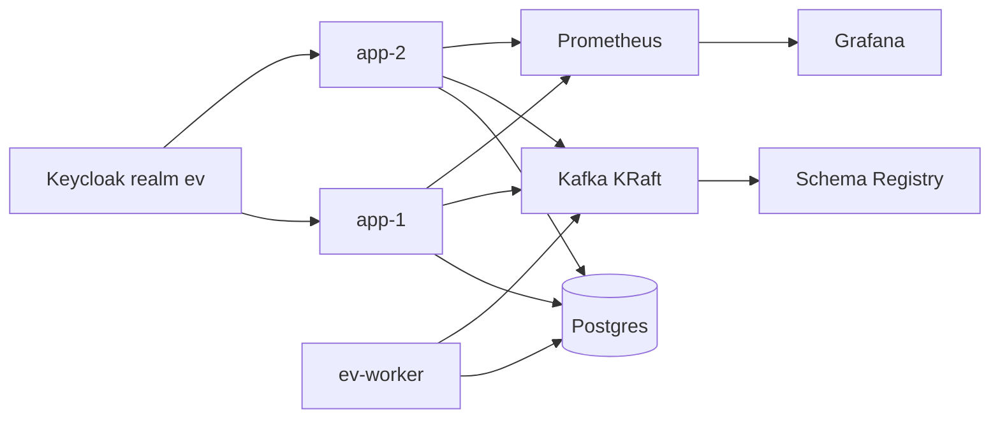
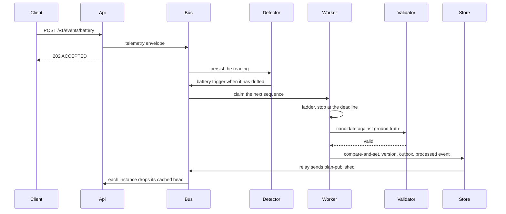

# Design note

Two web instances serve one fleet database. A plan becomes the head only after an independent validator accepts it. The web processes accept events and serve reads. The worker solves a plan job.

## Deployment

`ev_admin` owns the tables and runs Flyway, including the `ev_api` and `ev_worker` logins. The web instances connect as `ev_api`. That role is not a superuser, does not inherit table rights, and cannot assume `ev_relay`. Each request does `SET ROLE ev_app` and sets `app.tenant` from the token. The worker connects as `ev_worker` and is the only process that relays the outbox. It has no token. It copies the tenant from the trigger envelope, which the web process wrote from the token. Postgres row-level security still applies. Outbox rows wait if no worker is running.

Each web instance has its own Kafka consumer group, `ev-web-1` and `ev-web-2`, so a plan-published event reaches both caches. A shared group would deliver the event to only one of them. Topics are created before the processes start, and auto-create is off. A missing topic stops the process. The compose broker uses replication factor 1. Production is replication factor 3 with `min.insync.replicas=2`.

Keycloak realm `ev` puts `tenant_id` and `role` on the access token. The application checks the signature against the realm JWKS and does not trust a tenant in the request body. `POST /v1/plans` records an accepted job and a trigger in one transaction. It does not publish a head. The worker reads that trigger, solves the shard, and publishes only after the validator accepts a freshly loaded fleet. `GET /v1/plans/jobs/{jobId}` returns that job for the token tenant.

## Battery-drift re-plan

This is the drift path. A battery post returns 202 and leaves the reading on `ev.telemetry.v1`. The detector stores it and, when it has drifted from the published head, sends a trigger. The worker runs the ladder and publishes through `PlanPublication` only when the validator accepts the fresh fleet. A charger failure is stored as `FAULTY`, with an outage until the shard horizon, and the ladder moves sessions off that plug. The web process still does not solve.

The objective is fewer backup trips, then the change penalty times the number of changed assignments, plus charging cost. A batch that reaches the deadline keeps the last plan and marks it deadline-exhausted. A candidate the validator rejects is not stored. The compare-and-set refuses a writer that lost the race, and the previous head stays.

## What fails

| What fails | What the user sees | How it recovers |
|---|---|---|
| Solver killed mid-solve | The previous head | The sequence is stored only after the handler returns. `SolveKillTest` kills the solve before the write. `ZombieWorkerIT` pauses one worker; the other publishes, and the paused worker's later write loses compare-and-set |
| Deadline during a drift batch | The last validator-clean plan | The batch stops. The next event can repair again |
| Validator rejects the candidate | The previous head | Nothing is published. The seed on a stored version is what makes a past run reproducible |
| Duplicate or older message | No second change | The delivery watermark keeps the highest sequence |
| Poison payload | No change | Retry topics, then the dead-letter topic |
| Database unreachable on a write or a cache miss | 503 `UNAVAILABLE` with `Retry-After`. Readiness is down | The call waits at most the connect timeout, then the gate opens. A cached current head is still served inside its lifetime |
| Database drops during publish | The last committed head | The transaction rolls back. No partial version is stored |
| One web instance stops | The other instance | Both serve health, reads, and catalog writes. Killing one is the live failover |
| Kafka down | A battery post waits for the send bound, then 503. A plan post is stored. A head already stored is still readable | The outbox keeps the trigger until the broker accepts it |
| Cross-tenant read | 404 | The tenant comes from the token. Row-level security compares it again |

## Left out

The web process does not assemble a fleet from the admin tables, so it does not start the ladder. The worker does that for a plan job and for a battery or charger-failure trigger. A database the process cannot reach returns 503 `UNAVAILABLE` with `Retry-After` after the connect timeout. Further calls fail immediately until the gate allows one probe. Traces stay in the process. There is no collector. The distance cache is not passed into the solver. Compose is the deployment. There is no Kubernetes manifest and no second region. There is no learned consumption model, no external routing engine, and no Debezium connector. The outbox pump publishes rows a worker has already committed.
